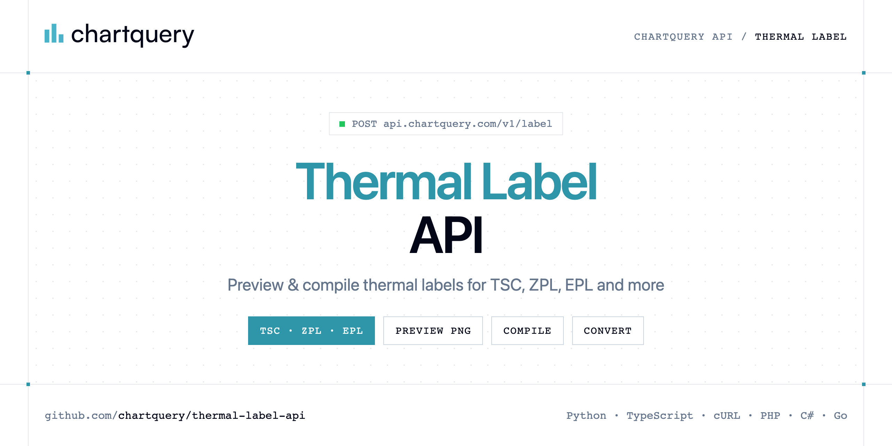

<p align="center">
  <a href="https://www.chartquery.com"></a>
</p>

# Thermal Label API

[](https://discord.gg/CFj3ph8aHU) [](https://app.chartquery.com/register) [](https://app.chartquery.com/openapi) [](LICENSE)

The **ChartQuery Thermal Label API** previews thermal labels as images and compiles or converts them to printer languages (TSC, ZPL, EPL, CPCL, ESC/POS…).

- **Label Preview API** — Preview a thermal label.
- **Label Compile API** — Compile a label to printer commands (tsc, zpl, epl, …).

Use it for shipping labels, product labels, receipts and warehouse printing.

| Endpoint | Request | Credits |
|---|---|---|
| [Label Preview API](#label-preview-api) | `POST /v1/label` | 3 |
| [Label Compile API](#label-compile-api) | `POST /v1/label/compile` | 3 |

## Table of contents

- [How it works](#how-it-works)
- [Label Preview API](#label-preview-api)
- [Label Compile API](#label-compile-api)
- [Code examples in other languages](#code-examples-in-other-languages)
- [Use cases](#use-cases)
- [Why ChartQuery?](#why-chartquery)
- [FAQ](#faq)
- [Official SDKs](#official-sdks)
- [Related repositories](#related-repositories)
- [Support](#support)

## How it works

1. **Create a ChartQuery account** and copy your API key from the [dashboard](https://app.chartquery.com/register).
2. **Call `https://api.chartquery.com`** with the header `x-api-key: YOUR_API_KEY`.
3. **Use the result** in your app — no infrastructure to run.

```bash
export CHARTQUERY_API_KEY="your-api-key"
pip install requests        # Python
# TypeScript: Node.js 18+ (native fetch), run with `npx tsx file.ts`
```

## Label Preview API

Preview a thermal label. POST a JSON object with width and elements. Do not send query. Text items use content and size (1-10 magnification), not text or fontSize. No barcode element; use /v1/barcode. Prefer format png so ChatGPT can display the image. Example: {"width":40,"height":30,"unit":"mm","language":"tsc","format":"png","elements":[{"type":"text","content":"Order: 1042","x":10,"y":10,"size":2},{"type":"text","content":"SKU: BOX-12","x":10,"y":35,"size":2}]}

`POST https://api.chartquery.com/v1/label` · **3 credits per request** · [API reference](https://app.chartquery.com/openapi)

### Request parameters

| Parameter | In | Type | Required | Description |
|---|---|---|---|---|
| `width` | body | int | ✅ | JSON body field |
| `height` | body | int | ✅ | JSON body field |
| `unit` | body | str | ✅ | JSON body field |
| `language` | body | str | ✅ | JSON body field |
| `format` | body | str | ✅ | JSON body field |
| `elements` | body | list | ✅ | JSON body field |

### Python example

```python
import os

import requests

API_KEY = os.environ["CHARTQUERY_API_KEY"]
HEADERS = {"x-api-key": API_KEY}

response = requests.post(
    "https://api.chartquery.com/v1/label",
    headers=HEADERS,
    json={'width': 40, 'height': 30, 'unit': 'mm', 'language': 'tsc', 'format': 'png', 'elements': [{'type': 'text', 'content': 'Order: 1042', 'x': 10, 'y': 10, 'size': 2}, {'type': 'text', 'content': 'SKU: BOX-12', 'x': 10, 'y': 35, 'size': 2}]},
    timeout=120,
)
response.raise_for_status()

with open("label.png", "wb") as f:
    f.write(response.content)
print("Saved label.png", len(response.content), "bytes")
```

### TypeScript example

```typescript
import { writeFile } from "node:fs/promises";

const headers = { "x-api-key": process.env.CHARTQUERY_API_KEY!, "Content-Type": "application/json" };

const response = await fetch("https://api.chartquery.com/v1/label", {
  method: "POST",
  headers,
  body: JSON.stringify({
  "width": 40,
  "height": 30,
  "unit": "mm",
  "language": "tsc",
  "format": "png",
  "elements": [
    {
      "type": "text",
      "content": "Order: 1042",
      "x": 10,
      "y": 10,
      "size": 2
    },
    {
      "type": "text",
      "content": "SKU: BOX-12",
      "x": 10,
      "y": 35,
      "size": 2
    }
  ]
}),
});
if (!response.ok) throw new Error(`HTTP ${response.status}: ${await response.text()}`);

await writeFile("label.png", Buffer.from(await response.arrayBuffer()));
console.log("Saved label.png");
```

### Output

The response body is the generated file (saved as `label.png` in every example). Error responses are JSON with an explanatory message.

## Label Compile API

Compile a label to printer commands (tsc, zpl, epl, …). POST width, language, and elements. Text uses content and size (1-10), not text or fontSize. No barcode element. Example: {"width":40,"height":30,"unit":"mm","language":"zpl","elements":[{"type":"text","content":"ACME","x":10,"y":10,"size":2},{"type":"text","content":"SKU: BOX-12","x":10,"y":35,"size":2}]}

`POST https://api.chartquery.com/v1/label/compile` · **3 credits per request** · [API reference](https://app.chartquery.com/openapi)

### Request parameters

| Parameter | In | Type | Required | Description |
|---|---|---|---|---|
| `width` | body | int | ✅ | JSON body field |
| `height` | body | int | ✅ | JSON body field |
| `unit` | body | str | ✅ | JSON body field |
| `language` | body | str | ✅ | JSON body field |
| `elements` | body | list | ✅ | JSON body field |

### Python example

```python
import os

import requests

API_KEY = os.environ["CHARTQUERY_API_KEY"]
HEADERS = {"x-api-key": API_KEY}

response = requests.post(
    "https://api.chartquery.com/v1/label/compile",
    headers=HEADERS,
    json={'width': 40, 'height': 30, 'unit': 'mm', 'language': 'zpl', 'elements': [{'type': 'text', 'content': 'Order: 1042', 'x': 10, 'y': 10, 'size': 2}, {'type': 'text', 'content': 'SKU: BOX-12', 'x': 10, 'y': 35, 'size': 2}]},
    timeout=120,
)
response.raise_for_status()

data = response.json()
print(data)
```

### TypeScript example

```typescript
type LabelCompileApi = string;

const headers = { "x-api-key": process.env.CHARTQUERY_API_KEY!, "Content-Type": "application/json" };

const response = await fetch("https://api.chartquery.com/v1/label/compile", {
  method: "POST",
  headers,
  body: JSON.stringify({
  "width": 40,
  "height": 30,
  "unit": "mm",
  "language": "zpl",
  "elements": [
    {
      "type": "text",
      "content": "Order: 1042",
      "x": 10,
      "y": 10,
      "size": 2
    },
    {
      "type": "text",
      "content": "SKU: BOX-12",
      "x": 10,
      "y": 35,
      "size": 2
    }
  ]
}),
});
if (!response.ok) throw new Error(`HTTP ${response.status}: ${await response.text()}`);

const data = (await response.json()) as LabelCompileApi;
console.log(data);
```

### Output example

Example response from the API reference, abridged.

```json
"SIZE 40 mm, 30 mm\nGAP 3 mm, 0\nSPEED 4\nDENSITY 8\nDIRECTION 1\nCLS\nTEXT 10,10,\"2\",0,1,1,\"ACME Corp\"\nTEXT 10,35,\"1\",0,1,1,\"SKU: PRD-00123\"\nBA…"
```

## Code examples in other languages

Ready-to-run examples live in [`examples/`](examples); each reads your key from `CHARTQUERY_API_KEY`.

| Language | `label-preview` | `label-compile` |
|---|---|---|
| cURL (Bash) | [label_preview.sh](examples/curl/label_preview.sh) | [label_compile.sh](examples/curl/label_compile.sh) |
| PHP | [label_preview.php](examples/php/label_preview.php) | [label_compile.php](examples/php/label_compile.php) |
| C# | [LabelPreview.cs](examples/csharp/LabelPreview.cs) | [LabelCompile.cs](examples/csharp/LabelCompile.cs) |
| Go | [label_preview.go](examples/go/label_preview.go) | [label_compile.go](examples/go/label_compile.go) |
| Java | [LabelPreviewExample.java](examples/java/LabelPreviewExample.java) | [LabelCompileExample.java](examples/java/LabelCompileExample.java) |
| Ruby | [label_preview.rb](examples/ruby/label_preview.rb) | [label_compile.rb](examples/ruby/label_compile.rb) |
| Node.js | [label_preview.mjs](examples/nodejs/label_preview.mjs) | [label_compile.mjs](examples/nodejs/label_compile.mjs) |

## Use cases

- **Label preview** — Show what a label looks like before printing.
- **Printer languages** — Generate TSC/ZPL commands from one JSON layout.
- **Migration** — Convert existing printer commands between languages.

## Why ChartQuery?

- **Images in one request** — the response body is the PNG/SVG/PDF, ready for emails, PDFs, dashboards, Slack or `` tags.
- **Charts, diagrams, QR codes, barcodes, labels** — Chart.js configs, 28 diagram languages (Mermaid, Graphviz, PlantUML, D2…), 25+ barcode formats.
- **AI generation** — describe a chart or diagram in plain English and get the rendered image.
- **No rendering infrastructure** — no headless browser, fonts or libraries to maintain.
- **Copy-paste examples** — Python and TypeScript in each README, 7 more languages in `examples/`.

## FAQ

### How do I authenticate?

Create an account on [ChartQuery](https://app.chartquery.com/register), copy your API key and send it in the `x-api-key` header of every request to `https://api.chartquery.com`.

### How much does a request cost?

Credits per call: `/v1/label` **3**, `/v1/label/compile` **3**. See [ChartQuery pricing](https://www.chartquery.com/pricing).

### What does the API return?

The response body is the file itself (image or document). Save it directly to disk or stream it to your storage — every example in this repository writes the file locally.

### Which languages are supported?

Any language that can make an HTTP request. This README shows Python and TypeScript; the [`examples/`](examples) folder contains cURL, PHP, C#, Go, Java, Ruby and Node.js.

## Official SDKs

Use ChartQuery from your own language with a typed client:

| SDK | Package | Install |
| --- | --- | --- |
| Node.js | [`@chartquery/sdk`](https://www.npmjs.com/package/@chartquery/sdk) | `npm install @chartquery/sdk` |
| Python | [`chartquery`](https://pypi.org/project/chartquery/) | `pip install chartquery` |
| Go | [`chartquery-go`](https://pkg.go.dev/github.com/chartquery/chartquery-go) | `go get github.com/chartquery/chartquery-go` |
| .NET | [`ChartQuery`](https://www.nuget.org/packages/ChartQuery) | `dotnet add package ChartQuery` |
| Ruby | [`chartquery`](https://rubygems.org/gems/chartquery) | `gem install chartquery` |
| PHP | [`chartquery/sdk`](https://packagist.org/packages/chartquery/sdk) | `composer require chartquery/sdk` |
| Java | [`chartquery-java`](https://github.com/chartquery/chartquery-java) | build from source, see its README |
| CLI | [`@chartquery/cli`](https://www.npmjs.com/package/@chartquery/cli) | `npm install -g @chartquery/cli` |
| MCP server | [`@chartquery/mcp`](https://www.npmjs.com/package/@chartquery/mcp) | `npx -y @chartquery/mcp` |

## Related repositories

- [Chart API](https://github.com/chartquery/chart-api)
- [Diagram API](https://github.com/chartquery/diagram-api)
- [QR Code API](https://github.com/chartquery/qr-code-api)
- [Barcode API](https://github.com/chartquery/barcode-api)
- [All ChartQuery repositories](https://github.com/chartquery)

## Support

- 💬 Join the [Discord](https://discord.gg/CFj3ph8aHU) to ask questions and share what you build.
- 📚 Read the [API reference](https://app.chartquery.com/openapi).
- 🔑 [Get your API key](https://app.chartquery.com/register).

---

<p align="center">
  <a href="https://www.chartquery.com">
    <picture>
      <source media="(prefers-color-scheme: dark)" srcset="images/logo-dark.svg">
      
    </picture>
  </a>
  <br>
  <sub>Built by <a href="https://www.chartquery.com">ChartQuery</a>. Examples are released under the MIT license.</sub>
</p>
